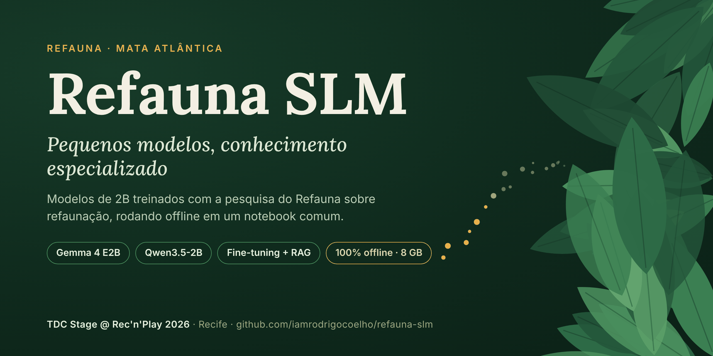
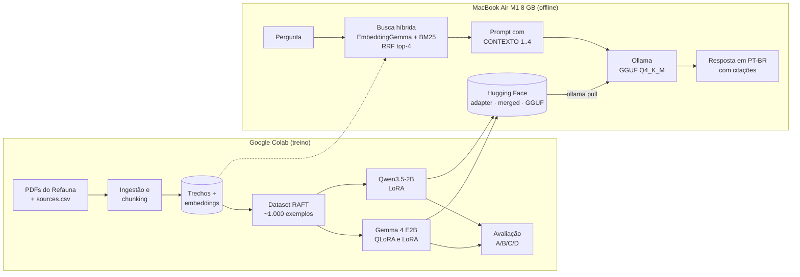

<p align="center">
  
</p>

<p align="center">
  <a href="https://huggingface.co/Refauna"></a>
  <a href="LICENSE"></a>
  
  
</p>

# Refauna SLM

**Small Language Models (SLMs) abertos, especializados na pesquisa do [Refauna](https://refauna.org.br) sobre refaunação e conservação da Mata Atlântica.**

O projeto combina **fine-tuning** e **RAG** em modelos de cerca de 2 bilhões de parâmetros (Gemma 4 E2B e Qwen3.5-2B). O resultado responde em português, cita os artigos usados e diz quando não sabe. Tudo roda **offline num MacBook Air M1 de 8 GB**.

- O **RAG** fornece os fatos: busca os trechos certos dos artigos e permite citar a fonte.
- O **fine-tuning** ensina o comportamento: responder em PT-BR a partir de fontes em inglês, citar `[n]`, recusar quando o acervo não cobre a pergunta e ser direto.

> Projeto apresentado no **TDC Stage @ Rec'n'Play 2026** (Recife, 11/11/2026), na palestra *"Pequenos modelos, conhecimento especializado: fine-tuning e RAG com os dados do Refauna"*.

*English: open small language models (Gemma 4 E2B, Qwen3.5-2B) fine-tuned and paired with RAG on Refauna's scientific papers about Atlantic Forest refaunation. Answers in Brazilian Portuguese with citations, fully offline on an 8 GB laptop. Models on Hugging Face, Apache 2.0.*

---

## Sumário

- [Experimente em 1 minuto](#experimente-em-1-minuto)
- [Modelos no Hugging Face](#modelos-no-hugging-face)
- [Small Language Models utilizados](#small-language-models-utilizados)
- [Como funciona](#como-funciona)
- [Resultados](#resultados)
- [Como usar este repositório](#como-usar-este-repositório)
- [Estrutura do repositório](#estrutura-do-repositório)
- [Documentação e PRD](#documentação-e-prd)
- [Dados e governança](#dados-e-governança)
- [Primeira versão do projeto](#primeira-versão-do-projeto)
- [Como citar](#como-citar)
- [Licença e agradecimentos](#licença-e-agradecimentos)

---

## Experimente em 1 minuto

Com o [Ollama](https://ollama.com) instalado, baixe e converse com um dos modelos (cerca de 2 a 3,5 GB):

```bash
# Qwen3.5-2B · Refauna (recomendado: mais rápido no M1)
ollama run hf.co/iamrodrigocoelho/qwen3.5-2b-refauna-GGUF:Q4_K_M --think=false

# Gemma 4 E2B · Refauna
ollama run hf.co/Refauna/gemma-4-e2b-refauna-GGUF:Q4_K_M
```

Pergunte, por exemplo: *"O que é refaunação?"* ou *"Por que reintroduzir cutias na Floresta da Tijuca?"*.

> Assim o modelo responde **sem RAG**, só com o que aprendeu no fine-tuning. Para respostas com citação dos artigos, use o app local com RAG ([abaixo](#como-usar-este-repositório)).

---

## Modelos no Hugging Face

Todos com licença **Apache 2.0**. Os modelos são publicados em até três formatos:

- **Adapter LoRA**: só os pesos treinados, para aplicar sobre o modelo-base (PEFT).
- **Merged**: modelo completo em 16 bits (Transformers).
- **GGUF**: quantizado (`Q4_K_M` e `Q8_0`) para Ollama e llama.cpp.

| Modelo | Método | Adapter LoRA | Merged | GGUF |
|---|---|---|---|---|
| **Gemma 4 E2B · Refauna** | QLoRA 4-bit | [gemma-4-e2b-refauna-lora](https://huggingface.co/Refauna/gemma-4-e2b-refauna-lora) | [gemma-4-e2b-refauna](https://huggingface.co/Refauna/gemma-4-e2b-refauna) | [gemma-4-e2b-refauna-GGUF](https://huggingface.co/Refauna/gemma-4-e2b-refauna-GGUF) |
| **Gemma 4 E2B · Refauna (LoRA 16-bit)** | LoRA 16-bit | — | [gemma-4-e2b-refauna-lora16](https://huggingface.co/iamrodrigocoelho/gemma-4-e2b-refauna-lora16) | [gemma-4-e2b-refauna-lora16-GGUF](https://huggingface.co/iamrodrigocoelho/gemma-4-e2b-refauna-lora16-GGUF) |
| **Qwen3.5-2B · Refauna** | LoRA 16-bit | [qwen3.5-2b-refauna-lora](https://huggingface.co/iamrodrigocoelho/qwen3.5-2b-refauna-lora) | [qwen3.5-2b-refauna](https://huggingface.co/iamrodrigocoelho/qwen3.5-2b-refauna) | [qwen3.5-2b-refauna-GGUF](https://huggingface.co/iamrodrigocoelho/qwen3.5-2b-refauna-GGUF) |

Organização do projeto no Hugging Face: **[huggingface.co/Refauna](https://huggingface.co/Refauna)**.

---

## Small Language Models utilizados

| Modelo | Papel no projeto | Tamanho | Licença |
|---|---|---|---|
| [**Gemma 4 E2B**](https://huggingface.co/google/gemma-4-e2b-it) (Google) | Modelo-base, ajustado com QLoRA 4-bit e com LoRA 16-bit (para comparar os métodos) | ~2B efetivos | Apache 2.0 |
| [**Qwen3.5-2B**](https://huggingface.co/Qwen/Qwen3.5-2B) (Alibaba Qwen) | Segundo modelo-base, ajustado com LoRA 16-bit e os mesmos dados. É o modelo principal da demo | ~2B | Apache 2.0 |
| [**EmbeddingGemma-300m**](https://huggingface.co/google/embeddinggemma-300m) (Google) | Embeddings da busca semântica do RAG, no Colab e no Mac | 300M | Gemma Terms of Use (modelo *gated*) |
| [Gemma 4 E4B](https://huggingface.co/google/gemma-4-e4b-it) e [Qwen3.5-4B](https://huggingface.co/Qwen/Qwen3.5-4B) | Candidatos testados na [primeira versão](#primeira-versão-do-projeto) (desempate sem treino). Trocados pelos de 2B para caber em 8 GB com folga | ~4B | Apache 2.0 |

Fora dos SLMs, o **Claude Sonnet 5.5** (Anthropic, via API) gerou o dataset sintético de perguntas e respostas e atuou como juiz na avaliação. Ele não roda no app nem é necessário para usar os modelos.

Ferramentas principais: [Unsloth](https://github.com/unslothai/unsloth) + TRL/PEFT (treino), [pymupdf4llm](https://github.com/pymupdf/pymupdf4llm) (PDF → Markdown), [ChromaDB](https://www.trychroma.com) + BM25 (busca híbrida), [Ollama](https://ollama.com) (inferência local), [Hugging Face](https://huggingface.co) (publicação).

---

## Como funciona



**Fine-tuning no formato do RAG (estilo [RAFT](https://arxiv.org/abs/2403.10131)).** O modelo foi treinado com o mesmo formato de prompt que recebe no app:

- ~60% dos exemplos trazem o trecho certo misturado a 3 distratores, com resposta citando `[n]`;
- ~15% trazem só trechos irrelevantes, e a resposta correta é dizer que não encontrou;
- ~25% vêm sem contexto.

O fine-tuning ensina a **ler, filtrar e citar**, e o RAG fornece os fatos.

---

## Resultados

Avaliação com quatro configurações sobre o conjunto de teste (perguntas de documentos que o modelo não viu no treino):

- **A**: modelo original, sem RAG.
- **B**: modelo original com RAG.
- **C**: modelo ajustado, sem RAG.
- **D**: modelo ajustado com RAG.

**Correção** (nota de 1 a 5 dada pelo juiz, ~60 perguntas):

| Modelo | A · original | B · original + RAG | C · ajustado | D · ajustado + RAG |
|---|---|---|---|---|
| Gemma 4 E2B (QLoRA) | 1,12 | **2,47** | 2,17 | 2,29 |
| Gemma 4 E2B (LoRA 16-bit) | 1,12 | **2,45** | 2,00 | 2,34 |
| Qwen3.5-2B (LoRA 16-bit) | 1,72 | **2,53** | 2,20 | 2,32 |

**Comportamento no Mac** (Qwen3.5-2B com RAG, 40 perguntas; original → ajustado):

| Métrica | Original + RAG | Ajustado + RAG |
|---|---|---|
| Cita o trecho certo | 17% | **54%** |
| Recusa quando o acervo não tem a resposta | 12,5% | **100%** |
| Recusa indevida (havia resposta) | 0% | 14% |
| Tamanho médio da resposta | ~270 tokens | **~70 tokens** |

**Desempenho no MacBook Air M1 8 GB** (GGUF `Q4_K_M` via Ollama, com RAG):

| Modelo | Tokens/s | Latência p50 | Tamanho do GGUF |
|---|---|---|---|
| Qwen3.5-2B · Refauna | **29,8** | **5,7 s** | 2,0 GB |
| Gemma 4 E2B · Refauna | 20,9 | 8,6 s | 3,4 GB |
| Qwen3.5-2B original | 21,6 | 19,6 s | — |

O pico de memória ficou em 5,7 GB, com um modelo carregado por vez.

**O que aprendemos:**

1. **O RAG deu o maior salto de correção.** A hipótese inicial (D > B > C > A) não se confirmou: com RAG, o ajuste não aumentou a nota de correção.
2. **O fine-tuning mudou o comportamento.** O modelo passou a citar mais, a recusar quando não sabe e a dar respostas 4× mais curtas e muito mais rápidas, o que importa num notebook de 8 GB.
3. **QLoRA × LoRA 16-bit** no Gemma 4 E2B tiveram curvas de perda e notas praticamente iguais. O QLoRA economizou só ~15% de memória neste modelo pequeno e foi mais lento (27,8 × 23,9 min).
4. **A busca é o gargalo.** Recall@4 de 0,42 e MRR@20 de 0,30: quando a busca erra o trecho, nenhum modelo acerta a citação.

Relatório completo: [`docs/avaliacao.md`](docs/avaliacao.md).

---

## Como usar este repositório

Há três jeitos de aproveitar o projeto, do mais rápido ao mais completo.

### 1. Só usar os modelos

Veja [Experimente em 1 minuto](#experimente-em-1-minuto). Funciona em qualquer máquina com Ollama e ~4 GB livres.

### 2. Rodar o app local com RAG (Mac ou Linux)

Pré-requisitos: Python 3.11, [uv](https://docs.astral.sh/uv/), [Ollama](https://ollama.com) e uma conta no Hugging Face com os termos do [EmbeddingGemma](https://huggingface.co/google/embeddinggemma-300m) aceitos.

```bash
git clone https://github.com/iamrodrigocoelho/refauna-slm.git
cd refauna-slm
uv sync
uv run hf auth login                 # necessário para baixar o EmbeddingGemma (gated)
cp .env.example .env                 # REFAUNA_DRIVE_DIR = pasta refauna-slm do seu Google Drive

uv run refauna models pull           # baixa os modelos no Ollama (com internet)
uv run refauna sync                  # copia os artefatos do Colab (Drive) para data/ e valida
uv run refauna index                 # monta o índice ChromaDB + BM25 a partir de data/chunks.jsonl
uv run refauna ask "O que é refaunação?" --model qwen_ft
uv run refauna serve                 # abre o app no navegador (http://127.0.0.1:7860)
```

Os nomes de modelo aceitos em `--model` são `qwen_ft`, `gemma_ft` e `qwen_base` (definidos em [`config/settings.yaml`](config/settings.yaml)). O `Makefile` tem atalhos: `make setup`, `make index`, `make ask Q="..."`, `make app`, `make check`.

> **Sobre os documentos:** os PDFs e os trechos dos artigos do Refauna **não são distribuídos** aqui, porque as licenças dos artigos ainda estão em verificação. Sem `data/chunks.jsonl`, o app **não abre**: `refauna index`, `refauna serve` e `refauna ask` com RAG param com o erro *"Falta data/chunks.jsonl. Rode `refauna sync` primeiro."*. Só `refauna ask "..." --no-rag` funciona sem documentos. Para usar o RAG, gere o seu `chunks.jsonl` com os seus documentos no Colab (opção 3) e traga com `refauna sync`, ou fale com o [Refauna](https://refauna.org.br).

### 3. Reproduzir o treino com os seus documentos (Google Colab)

| Notebook | O que faz | Abrir |
|---|---|---|
| `refauna_gemma4_finetune_rag.ipynb` | Pipeline completo: PDFs → trechos → índice → dataset RAFT → fine-tuning QLoRA do Gemma 4 E2B → avaliação → publicação | [](https://colab.research.google.com/github/iamrodrigocoelho/refauna-slm/blob/main/notebooks/refauna_gemma4_finetune_rag.ipynb) |
| `refauna_gemma4_lora16_finetune_rag.ipynb` | Mesmo treino com LoRA 16-bit, para comparar com o QLoRA | [](https://colab.research.google.com/github/iamrodrigocoelho/refauna-slm/blob/main/notebooks/refauna_gemma4_lora16_finetune_rag.ipynb) |
| `refauna_qwen35_2b_finetune_rag.ipynb` | Fine-tuning do Qwen3.5-2B com os mesmos dados e a mesma avaliação | [](https://colab.research.google.com/github/iamrodrigocoelho/refauna-slm/blob/main/notebooks/refauna_qwen35_2b_finetune_rag.ipynb) |

Passo a passo:

1. Coloque seus PDFs em `MyDrive/refauna-slm/training-files/` e descreva cada um num `sources.csv` (modelo em [`training-files/sources.example.csv`](training-files/sources.example.csv)).
2. Nos *Secrets* do Colab, cadastre `HF_TOKEN` e `ANTHROPIC_API_KEY` (este último gera o dataset e faz a avaliação).
3. Rode primeiro o notebook do Gemma (ele cria os trechos, o índice e o dataset). Os outros dois reaproveitam esses arquivos.
4. Troque `HF_USERNAME` pelo seu usuário para publicar no seu perfil.

---

## Estrutura do repositório

```
refauna-slm/
├── notebooks/            # Colab: ingestão, dataset, fine-tuning, avaliação, publicação
├── src/refauna_slm/      # RAG local: índice, busca híbrida, backend Ollama, avaliação, CLI
├── app/                  # app Gradio local (Chat · Comparar · Resultados)
├── config/               # settings.yaml (modelos, busca) e prompts.yaml (contrato de prompt)
├── tests/                # testes sem GPU e sem rede
├── scripts/              # ram_demo.py: medição de RAM com o app rodando
├── model_cards/          # model cards do Hugging Face gerados por `refauna cards`
├── training-files/       # sources.example.csv (os PDFs não são versionados)
├── docs/                 # PRD, decisões, avaliação, diário
├── primeira-versao/      # primeira abordagem (Gemma 4 E4B, Docling, Qdrant)
├── assets/               # capa e imagens do README
└── data/                 # NÃO versionado: trechos, índice e resultados locais
```

---

## Documentação e PRD

- [`docs/PRD.md`](docs/PRD.md): **documento de requisitos do projeto**. Ele guiou a construção da parte local com o Claude Code: arquitetura, contrato de prompt, requisitos, riscos e a sequência de prompts usada.
- [`docs/avaliacao.md`](docs/avaliacao.md): resultados completos da avaliação.
- [`docs/decisoes.md`](docs/decisoes.md): decisões técnicas e o porquê de cada uma.
- [`docs/diario.md`](docs/diario.md): tropeços e lições ao longo do caminho.

---

## Dados e governança

- Os PDFs e os dados de campo do Refauna **não ficam neste repositório**. O `.gitignore` bloqueia `data/`, PDFs, `*.gguf` e `.env`.
- Coordenadas, trilhas e pontos de soltura de animais nunca entram no índice nem no treino, pelo risco de caça.
- O dataset de treino só será publicado depois da verificação das licenças de cada artigo.
- Os model cards no Hugging Face listam os artigos usados, com DOI.

Regras completas: [`data/README.md`](data/README.md).

---

## Primeira versão do projeto

A pasta [`primeira-versao/`](primeira-versao/) guarda a primeira abordagem: Gemma 4 E4B, Docling, BGE-M3 e Qdrant, com notebooks de desempate entre modelos, ingestão e RAG. Ela foi substituída pela versão atual para caber com folga em 8 GB de RAM e para usar o mesmo modelo de embeddings no Colab e no Mac. Fica aqui como registro do processo.

---

## Como citar

```bibtex
@software{coelho_refauna_slm_2026,
  author  = {Coelho, Rodrigo},
  title   = {Refauna SLM: pequenos modelos com fine-tuning e RAG sobre a pesquisa do Refauna},
  year    = {2026},
  url     = {https://github.com/iamrodrigocoelho/refauna-slm},
  license = {Apache-2.0}
}
```

Os metadados também estão em [`CITATION.cff`](CITATION.cff).

---

## Licença e agradecimentos

O código está sob a licença **[Apache 2.0](LICENSE)**. Os modelos publicados seguem a licença dos modelos-base (Apache 2.0). O EmbeddingGemma segue os [Gemma Terms of Use](https://ai.google.dev/gemma/terms). Os artigos citados pertencem aos seus autores e editoras.

Agradecimentos:

- à equipe e aos pesquisadores do **[Refauna](https://refauna.org.br)**, que autorizaram o uso da sua produção científica;
- ao Google (Gemma, EmbeddingGemma), à equipe Qwen, à [Unsloth](https://unsloth.ai), ao [Ollama](https://ollama.com) e ao [Hugging Face](https://huggingface.co), pelas ferramentas abertas;
- ao TDC e ao Rec'n'Play, pelo espaço para mostrar o projeto.

Feito por [Rodrigo Coelho](https://github.com/iamrodrigocoelho), conselheiro pro bono do Refauna.
