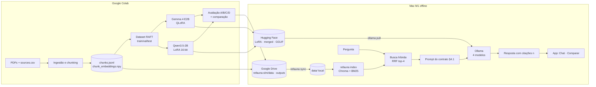

# PRD — Refauna SLM: Gemma 4 E2B e Qwen3.5-2B especializados com fine-tuning + RAG

> **Versão pública (v3.0, 11/11/2026)** do documento de requisitos usado para construir o projeto com o Claude Code.
> Palestra: *"Pequenos modelos, conhecimento especializado: fine-tuning e RAG com os dados do Refauna"*, TDC Stage @ Rec'n'Play 2026, Recife, 11/11/2026.
>
> O PRD descreve o que foi planejado. A implementação final está no código e pode diferir em detalhes (por exemplo, na interface do app). Resultados em [`avaliacao.md`](avaliacao.md).

---

## 0. Como o projeto foi construído

| Etapa | Onde | Status |
|---|---|---|
| Ingestão dos PDFs, limpeza, chunking, fichas do catálogo | Colab, notebook do Gemma, seções 1–2 | ✅ |
| Índice híbrido (EmbeddingGemma + BM25) e avaliação de recuperação | Colab, notebook do Gemma, seção 3 | ✅ |
| Dataset sintético RAFT + curadoria + split por documento | Colab, notebook do Gemma, seções 4–5 | ✅ |
| Fine-tuning **Gemma 4 E2B** (QLoRA 4-bit) + avaliação A/B/C/D | Colab, notebook do Gemma, seções 6–7 | ✅ |
| Fine-tuning **Gemma 4 E2B** (LoRA 16-bit), para comparar com o QLoRA | Colab, notebook LoRA 16-bit | ✅ |
| Fine-tuning **Qwen3.5-2B** (LoRA 16-bit) + avaliação A/B/C/D + comparação | Colab, notebook do Qwen | ✅ |
| Publicação no Hugging Face (adapter, merged, GGUF) | Colab | ✅ |
| RAG local offline + CLI + app de chat | Mac (Claude Code) | ✅ |
| Avaliação local (latência, RAM, paridade Colab × Ollama) e relatórios | Mac (Claude Code) | ✅ |

> **Regra para o Claude Code:** não reimplementar ingestão de PDFs, geração de dataset nem treino. O projeto local **consome os artefatos** produzidos no Colab (§4.2) e os modelos publicados no Hugging Face.

---

## 1. Contexto

O **Refauna** (https://refauna.org.br) é uma iniciativa criada em 2010 que promove a translocação e a reintrodução de vertebrados localmente extintos (dispersores de sementes, herbívoros etc.) em remanescentes de Mata Atlântica, com foco no estado do Rio de Janeiro.

O projeto demonstra, com um caso real e de impacto socioambiental, que **Small Language Models (SLMs) especializados** respondem bem sobre um domínio científico estreito, com baixo custo computacional, rodando **offline num MacBook Air M1 de 8 GB**, publicados abertamente no **Hugging Face** — e compara dois modelos-base abertos (Gemma 4 E2B × Qwen3.5-2B) com o mesmo protocolo.

### 1.1 Princípio de arquitetura (a tese da palestra)

| Técnica | O que resolve | O que NÃO resolve |
|---|---|---|
| **Fine-tuning (LoRA/QLoRA)** | Idioma (PT-BR), estilo, vocabulário ecológico, formato, **citar fontes** e **recusar** quando não há evidência, uso disciplinado do contexto | Memorizar fatos de forma confiável |
| **RAG** | Fatos atualizáveis e rastreáveis (com citação do artigo), sem retreinar | Ensinar o modelo a *usar bem* o contexto — modelos de 2B se perdem com contexto ruidoso |

**Decisão central:** o fine-tuning foi feito **no formato de RAG** (estilo RAFT): exemplos com o trecho correto misturado a distratores e resposta citando `[n]`, exemplos de abstenção e exemplos sem contexto. O fine-tuning ensina a *ler, filtrar e citar*; o RAG fornece os fatos.

---

## 2. Objetivos e não-objetivos

### 2.1 Objetivos
| # | Objetivo | Status |
|---|---|---|
| O1 | Pipeline de dados reprodutível (PDF → Markdown → chunks → índice) | ✅ Colab |
| O2 | Dataset de instrução em PT-BR (sintético + revisão humana amostral + gold opcional) | ✅ Colab |
| O3 | Fine-tuning do Gemma 4 E2B (QLoRA) no Colab Pro com Unsloth | ✅ Colab |
| O4 | **RAG local no Mac M1 8 GB, 100% offline** (Ollama + EmbeddingGemma + ChromaDB + BM25) com interface de chat | ✅ Mac |
| O5 | Avaliação comparativa A/B/C/D com números para slides; **mais** métricas locais (latência, RAM) | ✅ Colab / ✅ Mac |
| O6 | Publicação aberta no HF (LoRA, merged, GGUF, model cards) | ✅ |
| O7 | Material de palestra: roteiro de demo, gráficos, vídeo de backup | ✅ |
| O8 | Comparação entre modelos-base: **Qwen3.5-2B** com os mesmos dados, prompt e juiz | ✅ Colab |

### 2.2 Não-objetivos
- Treinar qualquer coisa no Mac; carregar LLMs com `transformers` no Mac.
- Reprocessar PDFs ou regerar o dataset localmente.
- Fine-tuning de visão/áudio (os dois modelos são multimodais, o projeto é só texto).
- Raciocínio "thinking": os dois modelos rodam **sem raciocínio** (Gemma: template `gemma-4`; Qwen: `enable_thinking=False` / `think: false`).
- Produção com SLA, autenticação, multiusuário, agentes/ferramentas.

---

## 3. Restrições e premissas

| Item | Restrição / premissa |
|---|---|
| Hardware local | MacBook Air M1, **8 GB RAM**. Um LLM GGUF Q4_K_M (~3 GB) + EmbeddingGemma float32 (~1,2 GB) + app ≤ ~5,5 GB. **Um LLM carregado por vez.** |
| Modelos publicados | Gemma 4 E2B FT (QLoRA) e Qwen3.5-2B FT (LoRA 16-bit), ambos Apache 2.0, ambos com GGUF `Q4_K_M` e `Q8_0`. |
| Repositórios HF | Públicos. **Cada modelo tem o repositório completo configurado em `settings.yaml`** (sem namespace fixo no código). |
| Embeddings | `google/embeddinggemma-300m` (gated: aceitar os termos no HF e fazer `hf auth login` no Mac; baixar uma vez com internet). **Não suporta float16** → float32 no MPS/CPU. Deve ser o **mesmo** modelo usado no Colab. |
| Artefatos do Colab | No Google Drive em `refauna-slm/data/` e `refauna-slm/outputs/` (§4.2). Copiados para a máquina local via `refauna sync` (Drive para desktop) ou download manual. |
| Idioma | Respostas sempre em **português do Brasil**. |
| Internet no evento | Assumir que **não haverá** → demo 100% offline; vídeo de backup. |

---

## 4. Arquitetura



### 4.1 Contratos compartilhados (CRÍTICO)

O system prompt, o formato do contexto e o modo sem raciocínio usados no **treino** devem ser **idênticos** na inferência local. Divergência é a causa nº 1 de modelo fine-tunado "piorar" depois de exportado.

**Fonte da verdade:** a célula "Contrato de prompt" do notebook do Gemma (o notebook do Qwen copia a mesma célula). `config/prompts.yaml` replica o texto e `tests/test_prompt_contract.py` compara os dois, extraindo `SYSTEM_PROMPT` diretamente do `.ipynb`.

**System prompt (um único parágrafo, frases separadas por um espaço):**
```
Você é o Assistente Refauna, especialista em defaunação, refaunação, reintrodução de fauna, dispersão de sementes, interações ecológicas e conservação da Mata Atlântica. Responda sempre em português do Brasil, de forma clara, didática e precisa. Quando houver CONTEXTO, use somente as informações dele e cite os trechos usados no formato [n]. Se o CONTEXTO não contiver a resposta, diga explicitamente que não encontrou essa informação nos documentos do Refauna e não invente dados, números, datas ou nomes de espécies.
```

**Mensagem do usuário com contexto** (montada por `build_user_message()` / `format_context()` / `short_ref()` — copiar do notebook, não reinventar):
```
CONTEXTO:
[1] (Cid et al., 2014 — Short-Term Success in the Reintroduction of the Red-Humpe...) <texto do chunk>
[2] (...) <texto>
[3] (...) <texto>
[4] (...) <texto>

PERGUNTA: <pergunta>
```
**Sem contexto:** apenas o texto da pergunta. **TOP_K = 4** (igual ao treino).

**Abstenção:** o detector `is_abstention()` (regex do notebook) é usado na avaliação local.

**Por modelo:**
| Família | Template | Raciocínio | Na API do Ollama |
|---|---|---|---|
| Gemma 4 E2B | `gemma-4` (sem thinking) | desligado | sem parâmetro extra |
| Qwen3.5-2B | ChatML nativo | **desligado** (o template do Qwen3.5 liga por padrão!) | **`"think": false`** em toda chamada; remover `<think>…</think>` residual |

**Schema `chunks.jsonl`** (gerado no Colab):
```json
{"chunk_id": "REF-L1-004_c0007", "idx": 7, "doc_id": "REF-L1-004", "title": "...", "authors": "Bruno Cid; L. Figueira; ...",
 "year": 2014, "doi": "10.1177/...", "license": "a verificar", "redistributable": false,
 "section": "Results", "section_canon": "results", "page_start": 4, "page_end": 5, "text": "...", "n_tokens": 312}
```
Fichas do catálogo: `chunk_id = "<doc_id>_ficha"`, `idx = -100`, `section_canon = "catalog"`, `page_start = page_end = 0`. Entram no índice; na UI, citar como "Ficha do catálogo".

**Schema SFT (`sft/test.jsonl`)**: `id, doc_id, kind (rag|unanswerable|closed_book), question_type, question, reference, messages[], oracle_index, source_chunk_ids[], context_chunk_ids[]`.

### 4.2 Artefatos de entrada (produzidos no Colab)

| Arquivo no Drive (`refauna-slm/…`) | Destino local | Uso |
|---|---|---|
| `data/chunks.jsonl` | `data/chunks.jsonl` | Índice do RAG (obrigatório) |
| `data/chunk_embeddings.npy` | `data/chunk_embeddings.npy` | Evita recalcular embeddings no M1 (usar só se `len == len(chunks)`) |
| `data/docs.jsonl` | `data/docs.jsonl` | Metadados para a UI e para atribuição |
| `data/sft/test.jsonl` | `data/sft/test.jsonl` | Avaliação local e teste de paridade |
| `training-files/sources.csv` | já está no Mac | Governança/licenças |
| `outputs/*/train_report.json`, `eval_resumo.csv`, `eval_resumo.json`, `eval_detalhado.csv`, `loss.png`, `eval_notas.png` | `data/outputs/<run>/` | Relatórios e slides |
| `outputs/comparacao_modelos.csv` e `.png` | `data/outputs/` | Slide Gemma × Qwen |
| `gold_questions.jsonl` (se existir) | `data/gold/` | Avaliação |

---

## 5. Estrutura do repositório

```
refauna-slm/
├── CLAUDE.md                             # regras permanentes para o Claude Code (§12)
├── PRD.md                                # este documento
├── README.md
├── pyproject.toml                        # uv, Python 3.11
├── Makefile                              # setup, sync, index, ask, eval, bench, app
├── .env.example                          # HF_TOKEN, REFAUNA_DRIVE_DIR, ANTHROPIC_API_KEY (opcional)
├── .gitignore                            # data/, training-files/*.pdf, *.gguf, .env, data/chroma/
├── training-files/                       # PDFs e sources.csv (fora do git; versiona-se só sources.example.csv)
├── notebooks/                            # executados no Colab (não alterar sem pedir)
│   ├── refauna_gemma4_finetune_rag.ipynb
│   ├── refauna_gemma4_lora16_finetune_rag.ipynb
│   └── refauna_qwen35_2b_finetune_rag.ipynb
├── config/
│   ├── settings.yaml                     # caminhos, TOP_K, embeddings, registro de modelos (§6 F2)
│   └── prompts.yaml                      # contrato §4.1
├── data/                                 # NÃO versionado — preenchido por `refauna sync`
│   ├── chunks.jsonl · chunk_embeddings.npy · docs.jsonl
│   ├── sft/test.jsonl · gold/gold_questions.jsonl
│   ├── outputs/<run>/…                   # relatórios vindos do Colab
│   ├── chroma/                           # índice local persistido
│   └── local_eval/                       # resultados da avaliação local
├── src/refauna_slm/
│   ├── config.py                         # pydantic-settings: .env + settings.yaml + prompts.yaml
│   ├── sync.py                           # copia/valida artefatos do Drive (§4.2)
│   ├── contract.py                       # SYSTEM_PROMPT, short_ref, format_context, build_messages, is_abstention, is_ptbr (cópia do notebook)
│   ├── index/
│   │   ├── embedder.py                   # EmbeddingGemma (encode_query / encode_document), float32, MPS
│   │   ├── vector_store.py               # ChromaDB persistente
│   │   └── lexical.py                    # BM25 + bm25_tokens (cópia do notebook)
│   ├── rag/
│   │   ├── retriever.py                  # hybrid_search: denso top-20 + BM25 top-20 → rrf_fuse → select_diverse → top-4
│   │   ├── backends.py                   # OllamaBackend (think:false p/ Qwen, keep_alive, streaming)
│   │   └── pipeline.py                   # ask(question, model, use_rag) -> {answer, citations, contexts, latency, tokens/s}
│   ├── eval/
│   │   ├── local_eval.py                 # A/B/C/D com Ollama no Mac (sem juiz; métricas automáticas)
│   │   ├── bench.py                      # latência p50/p95, tokens/s, RAM pico por modelo
│   │   └── report.py                     # docs/avaliacao.md + PNGs a partir de data/outputs e data/local_eval
│   └── cli.py                            # Typer: refauna sync|index|ask|eval|bench|report|serve
├── app/
│   └── gradio_app.py                     # Chat + Comparar (§6 F5)
├── docs/
│   ├── decisoes.md                       # ADRs curtos — base dos slides
│   ├── avaliacao.md                      # gerado por `refauna report`
│   └── roteiro-demo.md
└── tests/
    ├── test_prompt_contract.py           # prompts.yaml == SYSTEM_PROMPT do .ipynb; short_ref/format_context iguais
    ├── test_retriever.py                 # RRF, select_diverse, fichas do catálogo
    ├── test_backends.py                  # payload do Ollama (think:false p/ Qwen), limpeza de <think>
    └── test_sync.py
```

---

## 6. Requisitos funcionais (parte local)

### F1 — Sincronização de artefatos (`refauna sync`)
- **F1.1** Ler `REFAUNA_DRIVE_DIR` (ex.: `~/Library/CloudStorage/GoogleDrive-<conta>/Meu Drive/refauna-slm`) e copiar os arquivos da §4.2 para `data/`. Se a variável não existir, imprimir a lista exata de arquivos para baixar manualmente do Drive.
- **F1.2** Validar: `chunks.jsonl` com o schema §4.1; `chunk_embeddings.npy` com o mesmo número de linhas; `sft/test.jsonl` legível. Relatório: nº de documentos, trechos, fichas, exemplos de teste por `kind`.
- **Aceite:** `refauna sync` idempotente; falha com mensagem clara se faltar `chunks.jsonl`.

### F2 — Registro de modelos (`config/settings.yaml`)
```yaml
ollama:
  host: http://localhost:11434
  options: {temperature: 0.3, num_ctx: 4096, num_predict: 512}
models:
  gemma_base: {label: "Gemma 4 E2B (original)",   tag: "gemma4:e2b",  family: gemma}
  gemma_ft:   {label: "Gemma 4 E2B · Refauna",    tag: "hf.co/Refauna/gemma-4-e2b-refauna-GGUF:Q4_K_M", family: gemma}
  qwen_base:  {label: "Qwen3.5-2B (original)",    tag: "qwen3.5:2b",  family: qwen}
  qwen_ft:    {label: "Qwen3.5-2B · Refauna",     tag: "hf.co/iamrodrigocoelho/qwen3.5-2b-refauna-GGUF:Q4_K_M", family: qwen}
retrieval: {top_k: 4, n_candidates: 20, rrf_k: 60, embed_model: google/embeddinggemma-300m}
```
- `family: qwen` ⇒ enviar `"think": false`. Trocar de modelo ⇒ descarregar o anterior (`keep_alive: 0`).
- `refauna models pull` baixa os 4 modelos (com internet), e `refauna models check` confirma que estão disponíveis offline.

### F3 — Indexação e recuperação (`refauna index`)
- **F3.1** Construir ChromaDB persistente (`data/chroma/`, cosseno) a partir de `chunks.jsonl`, **reaproveitando `chunk_embeddings.npy`** quando válido; senão, calcular com EmbeddingGemma (`encode_document`, float32, MPS, batch 16) usando `index_text = f"{title} — {section}\n{text}"` (igual ao notebook).
- **F3.2** BM25 com `bm25_tokens` do notebook.
- **F3.3** `hybrid_search`: denso top-20 + BM25 top-20 → RRF (k=60) → `select_diverse` (remove vizinhos ±1 do mesmo documento) → top-4. **Copiar as funções do notebook.**
- **Aceite:** Recall@4 local ≈ o `retrieval_report` do Colab (diferença ≤ 0,03) no `sft/test.jsonl`; latência de busca < 300 ms no M1.

### F4 — Pergunta e resposta (`refauna ask`)
- `refauna ask "pergunta" --model gemma_ft|gemma_base|qwen_ft|qwen_base [--no-rag] [--show-context]`
- Monta mensagens com `build_messages()`, chama o Ollama (`/api/chat`, streaming), remove `<think>…</think>`, extrai citações `[n]` e as mapeia para (título, ano, seção, páginas ou "Ficha do catálogo").
- **Aceite:** com `gemma_ft` + RAG, resposta em PT-BR com citações válidas em < 15 s no M1.

### F5 — App Gradio (`refauna serve`)
- **Aba Chat:** seletor de modelo (4 opções), toggle "usar RAG", resposta em streaming, painel de fontes com cada `[n]` (título, ano, seção, trecho, DOI clicável).
- **Aba Comparar:** a mesma pergunta respondida **em sequência** por até 4 configurações escolhidas (ex.: Gemma original sem RAG × Gemma FT + RAG × Qwen FT + RAG), um modelo carregado por vez, mostrando tempo e tokens/s de cada. **É o momento "uau" da demo.**
- **Aba Resultados:** exibe `comparacao_modelos.png`, as tabelas A/B/C/D dos dois modelos e o resumo da avaliação local.
- Perguntas de exemplo pré-carregadas (5–8), escolhidas para a demo (inclusive uma sem resposta nos documentos, para mostrar a abstenção, e uma sobre o catálogo, ex.: "que estudos o Refauna tem sobre jabutis?").
- **Aceite:** app estável por 30 min com ≤ 6 GB de RAM; funciona com Wi-Fi desligado.

### F6 — Avaliação local e relatórios
- **F6.1 Paridade Colab × Ollama (`refauna eval --parity`):** 10 perguntas fixas do `sft/test.jsonl`, por modelo FT, com RAG, `temperature=0`. Comparar com `eval_detalhado.csv` do Colab: idioma, presença de citações, abstenção quando esperada. Divergência grande de formato ⇒ template de chat do GGUF errado (ver F7 / §10).
- **F6.2 A/B/C/D local (`refauna eval`):** sobre uma amostra do `sft/test.jsonl` (padrão 40), métricas **automáticas** (sem juiz): citação correta (cita um trecho do documento de origem), abstenção correta/falsa abstenção (`is_abstention`), % PT-BR (`is_ptbr`), latência. Juiz LLM opcional (`--judge`, requer `ANTHROPIC_API_KEY` e internet).
- **F6.3 Benchmark (`refauna bench`):** por modelo — latência p50/p95, tokens/s, RAM pico do processo do Ollama, tamanho do GGUF.
- **F6.4 Relatório (`refauna report`):** gera `docs/avaliacao.md` juntando os resultados do Colab (`data/outputs`) e locais (`data/local_eval`), mais PNGs prontos para slide (fundo claro, fonte grande).
- **Aceite:** `docs/avaliacao.md` com a tabela A/B/C/D dos dois modelos, a comparação Gemma × Qwen e o benchmark no M1; a hipótese "D > B > C > A" discutida honestamente (resultado negativo também é conteúdo).

### F7 — Hugging Face (manutenção)
- **F7.1** Model cards com tabela de avaliação, limitações e lista de artigos com DOI.
- **F7.2** Dataset de treino **não publicado** até a verificação das licenças dos artigos.
- **F7.3** Se o template de chat de algum GGUF divergir no Ollama, criar `ollama/Modelfile.<modelo>` com o `TEMPLATE` oficial do modelo-base (`ollama show gemma4:e2b --modelfile`, `ollama show qwen3.5:2b --modelfile`).

### F9 — CLI (resumo)
```
refauna sync                       # artefatos do Drive -> data/
refauna models pull|check          # baixa/verifica os 4 modelos no Ollama
refauna index [--rebuild]          # Chroma + BM25
refauna ask "pergunta" [--model gemma_ft] [--no-rag]
refauna eval [--parity] [--configs A,B,C,D] [--judge]
refauna bench
refauna report
refauna serve                      # Gradio
```

---

## 7. Referência — o que foi feito no Colab

Resumo para `docs/decisoes.md` e para os slides. Detalhes nos notebooks.

- **Corpus:** 93 trabalhos catalogados na planilha; **22 com texto utilizável** (14 artigos/capítulos/dissertação + 8 resumos), PT e EN. Ingestão guiada por `training-files/sources.csv` (`incluir_texto`, `paginas`).
- **Lições de extração** (bom conteúdo de palestra): o modo *layout* do pymupdf4llm 2.x transformava texto em duas colunas em tabelas → usado o modo clássico; artigos da *Oryx* codificam algarismos em caracteres de uso privado (U+F730–F739) → mapeados para 0–9, senão os números sumiam; listas de referências sem título detectadas por densidade.
- **Chunks:** ~310 trechos de texto (~400 tokens, sobreposição ~60) + 93 fichas do catálogo.
- **Dataset:** ~1.000 exemplos RAFT (~60% com contexto + citação, ~15% abstenção, ~25% sem contexto), gerados com Claude Sonnet 5.5, deduplicados, revisão humana amostral, **split por documento**.
- **Gemma 4 E2B:** QLoRA 4-bit, r=16, 2 épocas, lr 2e-4, template `gemma-4`, `train_on_responses_only`.
- **Gemma 4 E2B — LoRA 16-bit (3ª rodada):** mesmo modelo, dados, hiperparâmetros e avaliação do QLoRA; só `LOAD_IN_4BIT = False`. Isola o efeito do método (QLoRA × LoRA). Saída em `outputs/gemma4-e2b-refauna-lora16/`; publicação opcional em repositórios novos `Refauna/gemma-4-e2b-refauna-lora16{,-adapter,-GGUF}` (os do QLoRA não são alterados). Aqui a `eval_loss` **é** comparável com a do QLoRA (mesmo tokenizer).
- **Qwen3.5-2B:** **LoRA 16-bit** (a Unsloth não recomenda QLoRA no Qwen3.5), mesmos hiperparâmetros e **mesmos dados**, ChatML com `enable_thinking=False`, transformers v5.
- **Avaliação:** A (base) / B (base+RAG) / C (FT) / D (FT+RAG) com juiz LLM (correção, fidelidade), citação correta, abstenção, % PT-BR; recuperação Recall@4 e MRR. Resultados em `outputs/` (§4.2). A `eval_loss` **não** é comparável entre os dois modelos (tokenizers diferentes).

### 7.1 Auditoria dos arquivos
Dos 36 PDFs recebidos, só 26 eram únicos e **22 tinham o conteúdo esperado**. Havia cópias de uma dissertação não relacionada, páginas de política de privacidade e regulamentos salvos como PDF, e arquivos só com o título. Lição: **auditar o acervo antes de treinar**; o `sources.csv` passou a controlar o que entra (`incluir_texto`) e quais páginas usar (`paginas`).

---

## 8. Dados e governança

1. **Licenças:** a coluna `license` do `sources.csv` registra a licença de cada artigo; por padrão `redistributable = false`. Nada de trechos de artigos em repositórios públicos sem licença verificada.
2. **Autorização:** uso dos dados e do nome autorizado pelo Refauna e pelos autores.
3. **Dataset de treino:** só é publicado depois da verificação das licenças.
4. **Atribuição:** model cards e app listam os artigos com DOI.
5. **Sem dados pessoais:** e-mails de autores foram removidos na limpeza.

---

## 9. Requisitos não funcionais

- **Offline:** após `make setup`, `refauna models pull`, `refauna sync` e `refauna index`, tudo funciona sem internet (testar com Wi-Fi desligado).
- **Memória:** LLM só via Ollama; um modelo por vez; EmbeddingGemma float32 no MPS, batch ≤ 16; `num_ctx=4096`.
- **Reprodutibilidade:** `uv.lock`; seeds fixas (3407); versão do `chromadb` registrada no README.
- **Qualidade:** Python 3.11, `uv`, `ruff`, `pytest`, type hints, docstrings curtas em PT-BR.
- **Segredos:** `.env` (nunca versionado).

---

## 10. Riscos e mitigação

| Risco | Prob. | Impacto | Mitigação |
|---|---|---|---|
| Template de chat do GGUF diferente do treino → respostas piores no Ollama | Média | Alto | Teste de paridade (F6.1); Modelfile com template oficial (F7.3) |
| Qwen respondendo com raciocínio (`<think>`) | Média | Médio | `think: false` + limpeza de `<think>` + teste em `test_backends.py` |
| Swap no M1 com dois modelos carregados | Média | Alto | Um modelo por vez (`keep_alive: 0`); fechar navegador pesado na demo |
| Modelo não baixado antes do evento | Baixa | Alto | `refauna models pull` com internet + `refauna models check` offline no dia anterior |
| Sem internet no evento | Alta | Alto | Tudo baixado antes; **vídeo de backup** |
| FT não supera base+RAG em alguma métrica | Média | Baixo | Resultado válido; discutir na palestra |

---

## 11. Critérios de sucesso

- [x] Gemma 4 E2B (QLoRA e LoRA 16-bit) e Qwen3.5-2B fine-tunados e publicados (adapter + merged + GGUF) com model cards
- [x] Avaliação A/B/C/D dos modelos no Colab + comparação
- [x] Demo offline no M1: pergunta → resposta em PT-BR com citações em < 15 s
- [x] Comparação visível entre original × ajustado e com × sem RAG
- [x] Relatório de avaliação com resultados do Colab + benchmark no M1
- [ ] Licenças de todos os artigos verificadas, para publicar o dataset

---

## 12. Instruções para o Claude Code

Primeiro passo: criar o `CLAUDE.md` na raiz com:

1. **Contexto:** projeto da palestra do TDC (ver `PRD.md`). Treino e dados **já foram feitos no Colab**; este repositório é a **aplicação local**. Hardware: MacBook Air M1 8 GB — *nunca* propor treino local nem carregar LLMs com `transformers`.
2. **Não reimplementar** ingestão de PDFs, chunking, geração de dataset ou treino. Consumir os artefatos da §4.2.
3. **Contrato (§4.1) é lei:** copiar do notebook `SYSTEM_PROMPT`, `short_ref`, `format_context`, `build_user_message`, `build_messages`, `is_abstention`, `is_ptbr`, `bm25_tokens`, `rrf_fuse`, `select_diverse`. Teste de contrato extrai o texto direto do `.ipynb`.
4. **Qwen:** sempre `"think": false` e limpeza de `<think>`.
5. **Um modelo por vez** no Ollama (`keep_alive: 0` ao trocar).
6. **Repositórios do HF só no `settings.yaml`** (um por modelo); nenhum nome de repositório fixo no código.
7. **Fases** na ordem dos prompts abaixo. Ao fim de cada fase: `ruff`, `pytest`, mostrar o critério de aceite e fazer commit convencional (`feat:`, `fix:`, `docs:`).
8. **Nunca versionar** `data/`, PDFs, `*.gguf`, `.env`, `data/chroma/`.
9. **Não alterar** os notebooks em `notebooks/` sem pedir.
10. **Perguntar antes de:** publicar ou alterar algo no Hugging Face, apagar dados, mudar modelos ou o modelo de embeddings.

**Dependências** (`uv add`): `sentence-transformers>=5`, `chromadb`, `rank-bm25`, `ollama`, `gradio`, `typer`, `pydantic-settings`, `pyyaml`, `huggingface_hub`, `pandas`, `matplotlib`, `numpy`, `psutil`, `nbformat`; opcional `anthropic` (juiz); dev: `ruff`, `pytest`.

### Sequência de prompts usada

**Prompt 1 — fundação:**
> Leia o PRD.md inteiro e os dois notebooks em notebooks/. Crie o CLAUDE.md conforme a seção 13 e o scaffold da seção 5 (pyproject com uv, Makefile, config/settings.yaml e prompts.yaml, src/, tests/, .gitignore, .env.example). Implemente `refauna sync` (F1) e `refauna models pull/check` (F2) e o `src/refauna_slm/contract.py` copiando as funções do notebook, com `tests/test_prompt_contract.py`. Não implemente ingestão de PDFs nem treino. Pare e me mostre a saída de `refauna sync` e `refauna models check`.

**Prompt 2 — RAG local:**
> Implemente F3 (`refauna index`, reaproveitando chunk_embeddings.npy) e F4 (`refauna ask`) com o OllamaBackend (think:false para Qwen, um modelo por vez). Rode Recall@4 no sft/test.jsonl e compare com o retrieval_report do Colab. Depois rode o teste de paridade F6.1 para gemma_ft e qwen_ft e me mostre as divergências.

**Prompt 3 — app de demo:**
> Implemente o app Gradio da F5 (Chat, Comparar, Resultados) com 6 perguntas de exemplo para a demo. Teste com o Wi-Fi desligado e meça a RAM durante 10 perguntas seguidas.

**Prompt 4 — números para os slides:**
> Implemente F6.2–F6.4 (`refauna eval`, `refauna bench`, `refauna report`) e gere docs/avaliacao.md e os PNGs para slide. Em seguida escreva docs/decisoes.md (ADRs curtos) a partir da seção 7 do PRD e dos resultados.
