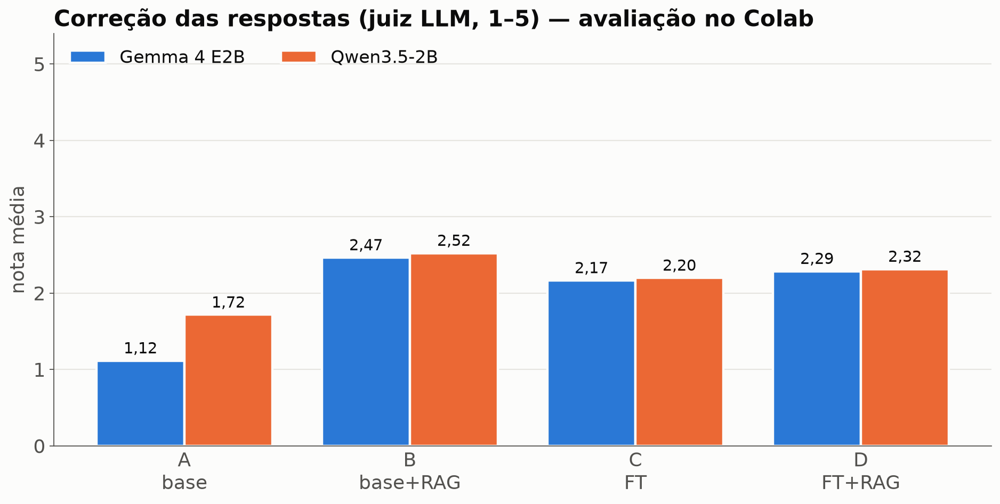
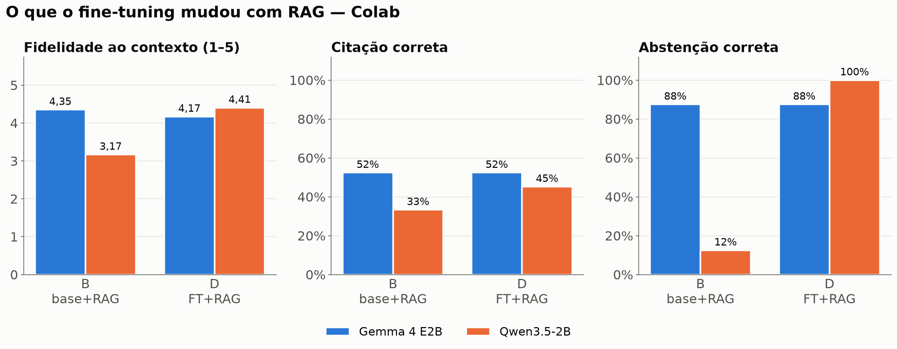
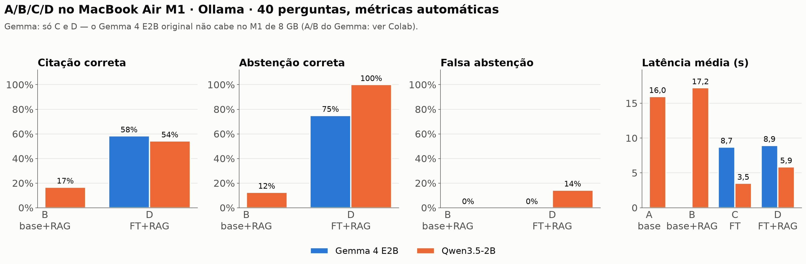
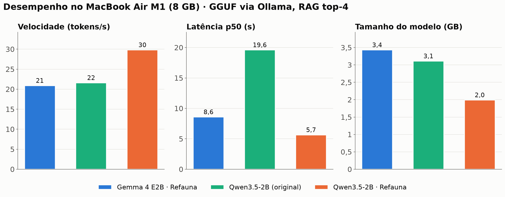

# Avaliação — Refauna SLM

_Gerado por `refauna report` em 02/11/2026. Não edite à mão: rode `refauna eval`, `refauna bench` e `refauna report` de novo._

## Resumo

- **Gemma 4 E2B** (Colab, juiz LLM): correção A 1.12 → D 2.29; o RAG é o maior salto (A → B 1.12 → 2.47); abstenção correta B 88% → D 88%.
- **Qwen3.5-2B** (Colab, juiz LLM): correção A 1.72 → D 2.32; o RAG é o maior salto (A → B 1.72 → 2.52); abstenção correta B 12% → D 100%.
- Recuperação híbrida idêntica no Mac e no Colab: Recall@4 = 0.419 (gargalo do sistema: em 58% das perguntas o trecho certo não chega ao top-4).
- No M1, o mais rápido é **Qwen3.5-2B · Refauna**: 30 tokens/s, latência p50 5.7 s.
- Demo com 10 perguntas seguidas (qwen_ft ↔ gemma_ft): pico app + Ollama = 5.70 GB (dentro do limite de 6 GB).

## Recuperação (EmbeddingGemma + BM25 + RRF, top-4)

| métrica | Colab | Mac (local) |
|---|---|---|
| recall@4 | 0.42 | 0.42 |
| mrr@20 | 0.30 | 0.30 |
| doc_recall@4 | 0.57 | 0.57 |

Busca média no M1: **50 ms** por pergunta (aceite: < 300 ms). n = 74 perguntas `rag` + `unanswerable` do teste.

## A/B/C/D no Colab (juiz LLM)

A = base · B = base + RAG · C = fine-tunado · D = fine-tunado + RAG. Correção e fidelidade de 1 a 5 (juiz `claude-sonnet-5-5`); citação, abstenção e PT-BR de 0 a 1; geração com temperatura 0.

### Gemma 4 E2B · `gemma4-e2b-refauna-qlora`

QLoRA 4-bit, r=16, 2 épocas · 942 exemplos · 27.8 min numa NVIDIA L4 · pico 10.57 GB de VRAM.

| config | correcao | fidelidade | citacao correta | abstencao correta | falsa abstencao | ptbr | latencia s |
|---|---|---|---|---|---|---|---|
| A: base | 1.12 | — | — | — | — | 1.00 | 4.28 |
| B: base+RAG | 2.47 | 4.35 | 0.52 | 0.88 | 0.00 | 1.00 | 13.03 |
| C: FT | 2.17 | — | — | — | — | 1.00 | 15.59 |
| D: FT+RAG | 2.29 | 4.17 | 0.52 | 0.88 | 0.00 | 1.00 | 11.34 |

### Qwen3.5-2B · `qwen3.5-2b-refauna-lora16`

LoRA 16-bit, r=16, 2 épocas · 942 exemplos · 14.9 min numa NVIDIA L4 · pico 7.94 GB de VRAM.

| config | correcao | fidelidade | citacao correta | abstencao correta | falsa abstencao | ptbr | latencia s |
|---|---|---|---|---|---|---|---|
| A: base | 1.72 | — | — | — | — | 1.00 | 17.10 |
| B: base+RAG | 2.52 | 3.17 | 0.33 | 0.12 | 0.00 | 1.00 | 14.32 |
| C: FT | 2.20 | — | — | — | — | 1.00 | 6.30 |
| D: FT+RAG | 2.32 | 4.41 | 0.45 | 1.00 | 0.00 | 1.00 | 4.45 |

## A hipótese D > B > C > A

- **Gemma 4 E2B** — ordem observada em correção: **B > D > C > A** (A 1.12 · B 2.47 · C 2.17 · D 2.29). Não confirma a hipótese D > B > C > A.
  - B → D (efeito do fine-tuning com RAG): fidelidade 4.35 → 4.17; citação correta 0.52 → 0.52; abstenção correta 0.88 → 0.88; latência (s) 13.03 → 11.34.
- **Qwen3.5-2B** — ordem observada em correção: **B > D > C > A** (A 1.72 · B 2.52 · C 2.20 · D 2.32). Não confirma a hipótese D > B > C > A.
  - B → D (efeito do fine-tuning com RAG): fidelidade 3.17 → 4.41; citação correta 0.33 → 0.45; abstenção correta 0.12 → 1.00; latência (s) 14.32 → 4.45.

**Leitura dos números:** em correção, o RAG sozinho (B) supera o fine-tuning sozinho (C) em todos os modelos — os fatos vêm da busca. O fine-tuning **não** levou D claramente acima de B em correção (diferença < 0,2 ou negativa): a correção com RAG fica limitada pela recuperação (Recall@4 = 0.42). No **Gemma 4 E2B**, de B para D: melhorou latência 13.03 → 11.34. No **Qwen3.5-2B**, de B para D: melhorou fidelidade 3.17 → 4.41, citação correta 0.33 → 0.45, abstenção correta 0.12 → 1.00, latência 14.32 → 4.45; piorou correção 2.52 → 2.32. Diferenças pequenas (< 0,2 nas notas, < 5 pontos nas taxas) estão dentro do ruído de amostras de ~60 perguntas.

## Gemma 4 E2B × Qwen3.5-2B (mesmos dados, prompt e juiz)

| modelo | método | min de treino | VRAM pico (GB) | correção D | fidelidade D | citação D | abstenção D | latência D (s) |
|---|---|---|---|---|---|---|---|---|
| Gemma 4 E2B | QLoRA 4-bit | 27.80 | 10.57 | 2.29 | 4.17 | 0.52 | 0.88 | 11.34 |
| Qwen3.5-2B | LoRA 16-bit | 14.90 | 7.94 | 2.32 | 4.41 | 0.45 | 1.00 | 4.45 |

A `eval_loss` **não** é comparável entre os dois (tokenizers diferentes).

## A/B/C/D no MacBook Air M1 (Ollama, métricas automáticas)

40 perguntas do `sft/test.jsonl` (60% `rag`, 20% `closed_book`, 20% `unanswerable`), temperatura 0, GGUF Q4_K_M (Qwen original: mxfp8). Sem juiz: citação correta = cita um trecho do documento de origem; abstenção correta = se abstém nas `unanswerable` (contexto fixo sem a resposta); falsa abstenção = se abstém numa pergunta respondível **com o trecho certo no contexto**. **Gemma original indisponível no M1** (a tag `gemma4:e2b` é nvfp4 de 7,5 GB): só C e D para o Gemma.

| modelo | config | n | ptbr | com citacao | citacao correta | abstencao correta | falsa abstencao | latencia s | tokens s | tokens resposta |
|---|---|---|---|---|---|---|---|---|---|---|
| Gemma 4 E2B | C: FT | 32 | 1.00 | — | — | — | — | 8.71 | 20.60 | 136.00 |
| Gemma 4 E2B | D: FT+RAG | 40 | 1.00 | 0.69 | 0.58 | 0.75 | 0.00 | 8.95 | 20.99 | 68.30 |
| Qwen3.5-2B | A: base | 32 | 1.00 | — | — | — | — | 15.96 | 21.66 | 329.00 |
| Qwen3.5-2B | B: base+RAG | 40 | 1.00 | 0.47 | 0.17 | 0.12 | 0.00 | 17.21 | 21.07 | 269.70 |
| Qwen3.5-2B | C: FT | 32 | 1.00 | — | — | — | — | 3.50 | 30.21 | 88.80 |
| Qwen3.5-2B | D: FT+RAG | 40 | 1.00 | 0.56 | 0.54 | 1.00 | 0.14 | 5.86 | 31.02 | 70.00 |

Bases das taxas com RAG: abstenção correta sobre 8 perguntas sem resposta; falsa abstenção sobre 14 perguntas `rag` em que o trecho certo foi recuperado (as mesmas para todos os modelos). Uma resposta muda a taxa em 7–13 pontos.

## Paridade Colab × Ollama (F6.1)

10 perguntas fixas, FT + RAG, temperatura 0, mesmas métricas automáticas nos dois lados. Divergência grande de formato indicaria template de chat errado no GGUF.

| modelo | PT-BR (Mac / Colab) | com citação | citação correta | abstenção em respondíveis | itens divergentes |
|---|---|---|---|---|---|
| gemma_ft | 100% / 100% | 71% / 71% | 60% / 60% | 29% / 29% | 1/10 |
| qwen_ft | 100% / 100% | 86% / 71% | 80% / 60% | 14% / 14% | 1/10 |

Idioma e presença de citações batem com o Colab: os templates de chat dos GGUF estão corretos.

## Benchmark no MacBook Air M1 (8 GB)

6 respostas a quente por modelo (perguntas da demo, RAG top-4, temperatura 0.3), depois de uma carga a frio com pergunta separada. **RAM Ollama** = pico de `phys_footprint` (macOS): quando o Ollama mapeia os pesos do disco (mmap), eles não entram nessa medida e o valor fica abaixo do tamanho do GGUF — por isso o gráfico mostra o tamanho do modelo, e o critério de RAM é verificado de ponta a ponta na seção seguinte.

| modelo | gguf gb | carga fria s | latencia p50 s | latencia p95 s | tokens s | prompt tokens s | tokens resposta | ram ollama pico gb |
|---|---|---|---|---|---|---|---|---|
| Gemma 4 E2B · Refauna | 3.43 | 9.70 | 8.59 | 11.51 | 20.90 | 277.00 | 92.80 | 0.32 |
| Qwen3.5-2B (original) | 3.11 | 5.10 | 19.60 | 27.44 | 21.60 | 296.20 | 325.80 | 4.27 |
| Qwen3.5-2B · Refauna | 1.99 | 4.90 | 5.65 | 8.48 | 29.80 | 356.80 | 90.20 | 1.32 |

Busca híbrida: 97 ms por pergunta · app com EmbeddingGemma (mps): 1.83 GB.

## RAM da demo (10 perguntas seguidas no app)

| modelos alternados | app (GB) | Ollama (GB) | pico juntos (GB) | ≤ 6 GB | um modelo por vez |
|---|---|---|---|---|---|
| qwen_ft ↔ gemma_ft | 1.91 | 3.82 | 5.70 | ✅ | ✅ |

O Gemma FT roda como variante **só-texto** (sem o projetor de visão/áudio de 0,99 GB do GGUF do HF); com o projetor, o pico era 6,55 GB.

## Limitações

- Amostras pequenas (Colab n ≈ 60 + 60 de abstenção; local n = 40): diferenças de poucos pontos são ruído.
- Correção e fidelidade vêm de um juiz LLM; as métricas locais são automáticas (regex de citação e abstenção).
- O Gemma original não roda no M1 de 8 GB; o Qwen original local está em mxfp8, não Q4_K_M como os fine-tunados.
- Perguntas sintéticas (geradas a partir dos trechos), com revisão humana amostral; sem gold set ainda.
